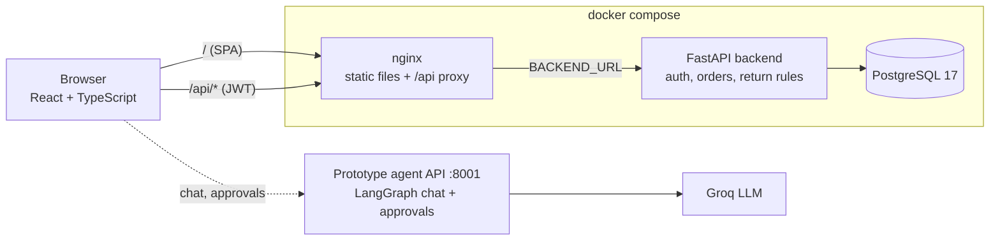
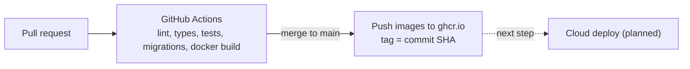

# Smart E-commerce Customer Support Agent (LangGraph)

[](https://github.com/nhatnguyen0503/ai-ecommerce-langgraph/actions/workflows/ci.yml)

**Live demo:** coming soon (cloud deployment is in progress).

A customer-support chatbot that actually looks up orders in a database, applies
Finland's 14-day consumer return window, and -- for refunds over 100 EUR --
pauses itself with LangGraph's **human-in-the-loop** interrupt until an admin
approves or rejects the request from a small dashboard. Once decided, the
agent resumes on its own and "emails" the customer the outcome.

- Backend: **Python 3.12, FastAPI, SQLAlchemy 2.0, LangGraph, Groq (via langchain-groq)**
- Data: **PostgreSQL 17** (Docker Compose) with **Alembic** migrations; SQLite also works for a quick run
- Frontend: **React 18 + TypeScript + Vite**, Redux Toolkit / RTK Query, React Router
- Tooling: **uv**, ruff, mypy, pytest (backend) · ESLint, Vitest, React Testing Library, MSW (frontend)
- DevOps: **Docker** (multi-stage images, docker compose), **GitHub Actions** (CI, images on ghcr.io)

> **Repository status -- work in progress**
>
> - `backend/app_reference/` is the original working prototype (full LangGraph chat and admin approval flow, kept as a reference).
> - `backend/app/` is the production-style rebuild. Done so far: typed settings (pydantic-settings),
>   layered architecture (router -> service -> repository), PostgreSQL + Alembic, JWT login with
>   admin and order-owner access, Docker images and CI/CD, with 122 backend tests + 15 frontend tests.
> - The LangGraph chat and admin flow are moved over from the prototype step by step, each through its own pull request.

## System overview





## How the human-in-the-loop flow works

_This flow runs in the prototype (`backend/app_reference/`) and is being moved into `backend/app/`._

```
START -> extract_intent (the LLM reads the message, pulls out an order id / return intent)
           |
           +-- no order id yet --------------------------------> respond -> END
           |
           v
       lookup_order (mock DB read)
           |
           +-- not found / just a status question --------------> respond -> END
           |
           v
       check_eligibility (Finland's 14-day return window, counted from delivery date)
           |
           +-- outside the window -------------------------------> respond -> END
           |
           v
       approval_gate (refund <= 100 EUR?)
           |
           +-- yes: auto_approved --------------------------+
           |                                                 v
           +-- no: escalate_for_approval -> wait_for_decision -> finalize (mock email) -> respond -> END
                                                   ^
                                      graph PAUSES here (interrupt()) and is
                                      persisted to SQLite via a LangGraph
                                      checkpointer. It can sit paused for as
                                      long as it takes -- across requests,
                                      even across backend restarts -- until
                                      POST /admin/approvals/{id}/decision
                                      calls Command(resume=...).
```

Each customer conversation is a LangGraph "thread" (`thread_id` = the chat
session id generated by the frontend). Because the graph's state is
checkpointed to SQLite (`backend/checkpoints.sqlite`), the pause survives
however long it takes an admin to act -- there's no request held open, no
background worker polling, and no risk of losing the conversation if the
backend restarts while a refund is pending.

The 100 EUR ceiling and the 14-day window are both configurable in
`backend/.env` (`AUTO_APPROVE_REFUND_CEILING_EUR`, `RETURN_WINDOW_DAYS`).

## Architecture (`backend/app`)

```
HTTP request
  -> routers/orders.py                 receives the request, calls the service
  -> services/order_service.py         business flow: normalizes the order id, runs the
       |                               14-day check, raises OrderNotFoundError
       +-> agent/business.py           pure rule: is the order still returnable?
  -> repositories/order_repository.py  database access (SQLAlchemy 2.0 select)
  -> PostgreSQL
```

Login and access control:

```
POST /auth/login
  -> routers/auth.py                   OAuth2 password form, rate limited per client
  -> services/auth_service.py          verifies the Argon2 hash, issues a JWT
  -> repositories/user_repository.py

Protected endpoints
  -> dependencies.py                   decodes the JWT -> CurrentUser / AdminUser
  -> order endpoints                   admin sees every order; a customer only their own (else 404)
```

- `dependencies.py` wires the layers per request with FastAPI `Depends` (session -> repository -> service).
- `errors.py` / `main.py` turn domain errors into one JSON error shape (`detail`, `request_id`) in one place.
- The decisions (order lookup, 14-day window, 100 EUR ceiling) are plain Python and fully tested.
  The LangGraph agent will call `OrderService` directly as its tools; the LLM only reads the
  customer's message and writes the reply.

## Project layout

```
docker-compose.yml            db + backend + nginx frontend
SECURITY.md                   security checklist and known gaps
.github/
  workflows/ci.yml            CI: lint, types, tests, migrations, Docker build, image publish
  pull_request_template.md
backend/
  Dockerfile                  multi-stage image (uv), runs migrations then uvicorn
  app/
    routers/                  HTTP endpoints (auth, orders)
    services/                 business flow (AuthService, OrderService)
    repositories/             database access (OrderRepository, UserRepository)
    agent/business.py         pure business rules (14-day return window)
    security.py               password hashing (Argon2) and JWT
    dependencies.py           per-request wiring, current user and admin checks
    rate_limit.py             login rate limiter
    create_user.py            CLI to create accounts in production
    models.py, schemas.py, database.py, config.py, seed.py, main.py
  app_reference/              original prototype (LangGraph chat + admin approval flow)
  alembic/                    database migrations
  tests/                      unit and API tests (pytest)
  pyproject.toml, uv.lock     dependencies managed by uv
frontend/
  Dockerfile                  builds the app, serves it with nginx
  default.conf.template       nginx config (BACKEND_URL is filled in at start)
  src/
    components/               ChatWidget, AdminDashboard, OrdersTable
    features/                 auth (Redux slice, RequireAdmin) and chat state
    pages/                    LoginPage, NotFound
    services/                 RTK Query APIs (backendApi, agentApi)
    store.ts                  Redux store
    test/                     test setup, MSW mock server, render helpers
```

## API (current rebuild)

| Method | Path | Access | What it does |
| --- | --- | --- | --- |
| GET | `/health` | public | Health check |
| POST | `/auth/login` | public (rate limited) | OAuth2 password form → JWT access token |
| GET | `/auth/me` | logged in | The current user (`id`, `email`, `role`) |
| GET | `/orders` | admin | List all orders |
| GET | `/orders/{order_id}` | admin or order owner | One order; the id is case-insensitive (`fi-10234` works) |
| GET | `/orders/{order_id}/return-eligibility` | admin or order owner | Is the order inside the 14-day return window? |

Errors use one shape: `{"detail": ..., "request_id": ...}`. A customer asking for someone
else's order gets the same `404` as for a missing order.

## Quick start with Docker

The whole app (PostgreSQL, FastAPI backend, React frontend behind nginx) runs with one command.
You only need [Docker Desktop](https://www.docker.com/products/docker-desktop/) — no Python or Node.

### 1. Create the env files

```bash
cp backend/.env.example backend/.env
cp backend/.env.docker.example backend/.env.docker
```

Then edit them — these values are required:

- `POSTGRES_PASSWORD` (in `backend/.env`) — password for the database user.
- `JWT_SECRET_KEY` (in `backend/.env`) — signs login tokens. Generate one with
  `openssl rand -hex 32`.
- `SEED_DEMO_PASSWORD` (in `backend/.env`) — password for the demo accounts created
  on first start (dev only, never used when `APP_ENV=prod`).
- `DATABASE_URL` (in `backend/.env.docker`) — same user, password and database name as
  in `backend/.env`. The host must be `db`: inside Docker, containers reach each other
  by their compose service name, and `localhost` would point to the backend container itself.

Both files are git-ignored. Never commit real secrets.

### 2. Start everything

```bash
docker compose up --build -d
docker compose ps        # db and backend should show "(healthy)"
```

On startup the backend waits for PostgreSQL to be healthy, applies all database
migrations (`alembic upgrade head`), then seeds sample orders and demo users.
The first build takes a few minutes; later builds reuse cached layers.

### 3. Open the app

Open <http://localhost:3000> and log in on the **Admin dashboard** tab with:

- email: `admin@example.fi`
- password: the `SEED_DEMO_PASSWORD` you set in `backend/.env`

The orders table loads from the API through nginx (`/api/...`).

nginx forwards `/api/...` to the address in `BACKEND_URL` (default `http://backend:8000`,
the backend service in docker compose). It is read when the container starts, so the same
frontend image can run elsewhere with `-e BACKEND_URL=https://<your-backend-host>`.

Customer demo accounts use the order emails, e.g. `aino@example.fi`.

### Useful commands

```bash
docker compose logs -f backend   # follow backend logs
docker compose down              # stop and remove containers (data is kept)
docker compose up --build -d     # rebuild after code changes
```

> ⚠️ `docker compose down -v` also deletes the `pgdata` volume, i.e. **all database data**.

### Creating users in production

Demo users are only seeded in development. With `APP_ENV=prod`, create accounts with the
built-in command (the password is asked twice and never shown or passed as an argument):

```bash
docker compose exec backend python -m app.create_user --email admin@example.com --role admin
```

Roles: `admin` or `customer` (default). Passwords must be 12–128 characters.

### Current limitations

- Chat and refund approvals still need the prototype agent API on port 8001, which is
  not part of the Docker setup yet (see "Running it without Docker" below).
- Swagger UI (`/docs`) is not reachable: the backend does not publish a port, only nginx
  talks to it on the internal Docker network. Run the backend without Docker to use `/docs`.

## Running it without Docker (development)

Prerequisites: [Docker Desktop](https://www.docker.com/products/docker-desktop/),
[uv](https://docs.astral.sh/uv/), and Node.js for the frontend.

### 1. Database

From the repository root:

```bash
cp backend/.env.example backend/.env
# Edit backend/.env: set POSTGRES_PASSWORD, use the same password in DATABASE_URL,
# and paste your GROQ_API_KEY.
docker compose up -d db
docker compose ps        # wait until STATUS shows "healthy"
```

No Docker? Set `DATABASE_URL=sqlite:///./ecommerce.db` in `backend/.env` and skip this step.

### 2. Backend

```bash
cd backend
uv sync                          # install dependencies from uv.lock
uv run alembic upgrade head      # create the tables
uv run uvicorn app.main:app --reload
```

On first startup the app seeds 5 sample Finnish orders (`FI-10234` .. `FI-10238`)
covering every case: a cheap auto-approved return, an expensive one that needs admin
approval, an order past the 14-day window, and one that hasn't been delivered yet.
See `backend/app/seed.py` for the exact numbers.

API docs are served at `http://localhost:8000/docs`.

### 3. Tests

```bash
cd backend
uv run pytest
```

Tests use in-memory SQLite and FastAPI `dependency_overrides`, so they need no Docker.

### 4. Frontend and the full chat loop (prototype)

The chat and admin endpoints still live in the prototype. Run it on its own SQLite file:

```bash
cd backend
DATABASE_URL=sqlite:///./prototype.db uv run uvicorn app_reference.main:app --reload --port 8001
```

Then the frontend:

```bash
cd frontend
npm install
cp .env.example .env        # API on :8000, prototype agent on :8001
npm run dev
```

Open `http://localhost:5173`. The **Customer chat** tab is the storefront
widget; the **Admin dashboard** tab is where refunds over 100 EUR show up for
approval, alongside a log of every (mocked) outbound email.
The Admin dashboard needs an admin login (`admin@example.fi` and your `SEED_DEMO_PASSWORD`).

1. In the chat tab: `I want to return order FI-10236, it arrived damaged.`
   FI-10236 is a delivered, in-window, 219 EUR order -- above the 100 EUR
   ceiling, so the agent says the request is submitted for review.
2. Switch to the Admin dashboard tab -- the request appears within ~5s.
   Click **Approve** (or **Reject**).
3. Switch back to the chat tab -- within a few seconds it shows the agent's
   final message, and the email log shows the mocked confirmation email.
4. Try `I want to return order FI-10234` (29.90 EUR) to see the auto-approve path.
5. Try `I want to return order FI-10235` (delivered 18 days ago) to see the
   14-day policy reject it.

## Development workflow

- Every change goes through a branch and a pull request; `main` is protected and needs all
  four CI checks (backend, migrations, frontend, docker) to pass.
- Commit messages follow [Conventional Commits](https://www.conventionalcommits.org/)
  (`feat:`, `fix:`, `docs:`, `ci:` ...); pull requests are squash-merged.
- After a merge to `main`, CI publishes both images to GitHub Container Registry,
  tagged with the commit SHA and `latest`.

Checks to run before opening a pull request:

```bash
# backend
cd backend && uv run ruff check . && uv run ruff format --check . && uv run mypy && uv run pytest
# frontend
cd frontend && npm run lint && npm run typecheck && npm run test:run && npm run build
```

## Notes / what's mocked vs. real

- **Orders**: seeded into the database by `seed.py`. In production this would be a
  call into the existing Laravel order API -- only `OrderRepository` would change.
- **Email**: mocked in the prototype (logged and stored in a `sent_emails` table).
- **Auth**: JWT login, Argon2 password hashing, admin vs. order-owner access, login rate
  limiting. See [SECURITY.md](SECURITY.md) for the full checklist and known gaps.
- **LLM**: Groq (`GROQ_MODEL` in `.env`, default `llama-3.3-70b-versatile`; check
  [console.groq.com](https://console.groq.com) for the current model catalog). It is used
  only to read the customer's intent and phrase the reply; all business decisions are
  deterministic Python.
